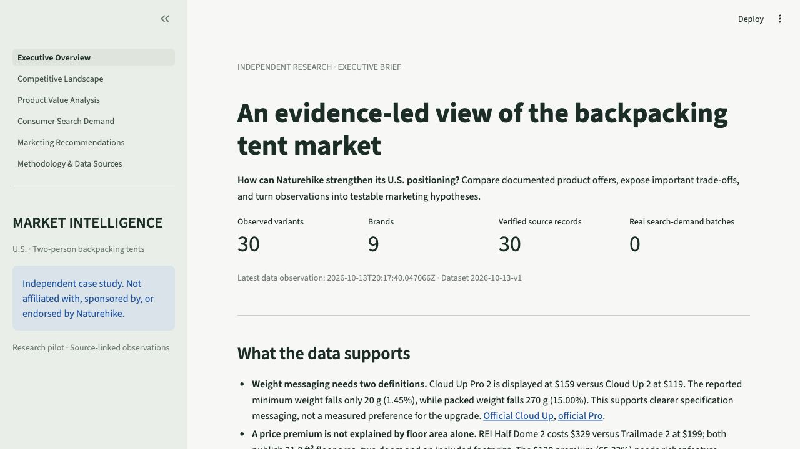
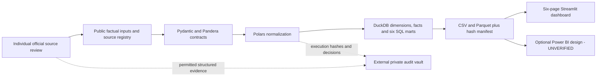

## Public research atlas (new stacked implementation)

The static Next.js/TypeScript experience is under `web/`. It adds illustrated stories, scoped charts/tables, 30 variant dossiers, 2–4 item comparisons, source drawers, shareable state and public downloads. It is a local production preview; no public deployment has occurred. The work is stacked on PR #1, which remains unmerged.

```sh
uv sync --locked
uv run python scripts/build_data.py
uv run python scripts/export_web.py
cd web
# Use Node 24.21.0 and npm 10.9.2
npm ci
npm run build
npm run preview
```

[Web specification](docs/WEB_EXPERIENCE_SPEC.md) · [Design](DESIGN.md) · [Release and rollback](docs/WEB_RELEASE_CHECKLIST.md) · [Toolchain sources](docs/TOOLCHAIN_SOURCES.md)


The three missing prices, empty real Trends data, proposed experiments and UNVERIFIED Power BI runtime remain explicit. Frontend parity checks use canonical Python/DuckDB vectors. Original observation dates are preserved; this web implementation does not claim a new live product-source review.

# Naturehike U.S. Market Intelligence & Growth Strategy

**This independent analytical project is not affiliated with, sponsored by, or endorsed by Naturehike.**

A source-linked case study of two-person backpacking tents advertised to U.S. consumers. It connects product research, Python/SQL data engineering and a six-page business dashboard to three testable marketing initiatives. It uses no internal Naturehike data, sales estimates or invented experiment outcomes.

**Current release candidate: v0.1.0.** 30 source-verified variant specification records across 9 brands, with 27 verified display prices. Missing values remain null. Streamlit works independently of Power BI. Google Trends analysis is incomplete because no real export was supplied. Power BI model/DAX design is **UNVERIFIED**; no functioning Power BI report is claimed. Prices are advertised observations, including sold-out listings, not confirmed purchase availability.

## Business questions and verified findings

1. **Competitive positioning:** How do documented price, declared weight and features differ within comparable product groups?
2. **Consumer demand:** How does relative U.S. search interest vary within a documented Google Trends batch? **Awaiting real exports.**
3. **Growth strategy:** Which evidence-linked customer/message/channel hypotheses should be tested?

The Cloud Up Pro comparison shows a 20 g reported minimum-weight reduction but a 270 g packed-weight reduction. The sampled Half Dome/Trailmade offers share floor area, door count and footprint inclusion despite a USD 130 display-price gap. Accessory inclusion also differs across offers, preventing unsupported complete-kit savings claims. These are bounded product observations, not measured consumer preferences or proof of quality. See the [business findings](docs/BUSINESS_FINDINGS.md), [claims register](docs/CLAIMS_REGISTER.md) and three **NOT EXECUTED** initiatives in the [marketing strategy](docs/MARKETING_STRATEGY.md).

## Dashboard

Six pages: Executive Overview, Competitive Landscape, Product Value Analysis, Consumer Search Demand, Marketing Recommendations, and Methodology & Data Sources. Each analytical chart identifies units, filters, observation period and source scope. Unknown attributes are excluded from controlled cohorts; price ranges are not substituted for variant prices. The demand page clearly shows missing real inputs.



[Competitive landscape screenshot](outputs/public/charts/screenshots/competitive-landscape.jpg) · [Product analysis screenshot](outputs/public/charts/screenshots/product-value-analysis.jpg) · [Demand status](outputs/public/charts/screenshots/consumer-search-demand.jpg) · [Marketing](outputs/public/charts/screenshots/marketing-recommendations.jpg) · [Methodology](outputs/public/charts/screenshots/methodology-data-sources.jpg)

These are genuine local Streamlit screenshots. They are not Power BI screenshots. No hosted dashboard URL is published in this release candidate.

## Architecture



Python 3.12 and uv; Polars, Pydantic, Pandera, DuckDB, SciPy, Plotly and Streamlit. Ruff, SQLFluff, Pytest, pre-commit, Gitleaks and GitHub Actions provide verification. Cryptography is used only for encrypted local audit backups. No hosted database, cloud credentials, scraper, unofficial Trends client or unnecessary distributed infrastructure is required.

## Sources, model and methods

Public factual observations come from brand-owned official pages and official REI retailer listings, with publisher/vendor roles distinguished. The [source registry](data/public/raw/sources.json), [product records and per-field evidence](data/public/raw/products.json), [exclusion log](data/public/raw/exclusions.json), [dictionary](docs/DATA_DICTIONARY.md) and [source policy](docs/SOURCE_POLICY.md) expose the collection boundaries. Tier A source verification means populated facts were checked against the identified source; it does not independently validate manufacturer performance or establish blanket website-content reuse rights.

Price facts preserve variant/source/time grain and historical snapshots. SQL selects one deterministic current canonical offer per variant. Controlled comparisons match season, structure, wall construction and footprint inclusion. Minimum/trail and packed/packaged definitions remain separate; unknown and Typical weights are not silently mapped. Descriptive medians, ranges, interquartile spread, missingness and sensitivity checks support the analysis. A price-weight Pareto frontier is scoped to one cohort and does not measure overall quality. No representative confidence interval or unsupported significance test is reported.

Google Trends exports require exact terms/topics, US geography, period, category, search type, export UTC time and a joint normalization batch. The [manual adapter guide](docs/GOOGLE_TRENDS.md) and isolated **TEST DATA** fixtures demonstrate ingestion without publishing synthetic demand findings. Brand interest is never joined to individual products as sales.

## Reproduce locally

Clone the implementation branch until its PR is merged:

```bash
git clone --branch codex/public-market-experience https://github.com/duhaolei43-source/naturehike-intelligence.git
cd naturehike-intelligence
uv sync --locked
uv run ruff check .
uv run ruff format --check .
uv run sqlfluff lint sql powerbi/model_spec/reference_queries.sql
uv run pytest -q
uv run python scripts/validate_data.py
uv run python scripts/build_data.py
uv run python scripts/reproducibility_smoke.py
uv run python scripts/verify_release.py
uv run streamlit run app/streamlit_app.py
```

Dataset: **2026-10-13-v1**. Reviewed analytical CSV/Parquet tables and input/output hashes are in [data/public/processed](data/public/processed). `market.duckdb` is generated locally and ignored by Git. Charts and descriptive summaries are under [outputs/public](outputs/public). Routine builds and CI are offline and need neither private credentials nor the private research archive. See [reproduction details](docs/REPRODUCIBILITY.md).

Local verification: **48 tests pass**, including source contracts, prices, units, null handling, variant identity, duplicate listings, time snapshots, Trends metadata/censoring, SQL aggregates, golden outputs, six dashboard pages, encrypted-backup roundtrip and public/private separation. Two isolated builds produce identical CSV/Parquet hashes. No test coverage percentage is claimed. The [CI workflow](.github/workflows/ci.yml) runs lint, format, contracts, unit/integration tests, reproducibility, release safety and a pinned Gitleaks scan. See [Actions](https://github.com/duhaolei43-source/naturehike-intelligence/actions) for actual remote results.

## Power BI and audit boundaries

Validated import exports, a star-model design, the required explicit DAX measures, six report-page plans and DuckDB comparison queries are in [powerbi](powerbi/README.md). The authoring design follows official Microsoft references. Runtime model creation, PBIP/TMDL/PBIR report authoring, filter testing and DAX parity require a supported Windows/Fabric environment and remain unverified. No PBIX or screenshots are fabricated.

Private evidence, decisions, environment/test records and execution manifests remain outside Git at the owner's external AUDIT_ROOT. Local restrictive permissions, SHA-256 event chaining, a tracked-file release guard and encrypted backup tooling protect that boundary. The archive is owner-controlled, not immutable or tamper-proof. CI does not upload private artifacts or generate unreviewed marketing conclusions.

## Limits and next steps

Convenience assortment, one collection date, incomplete materials/component controls, retailer caching and sold-out advertising constrain interpretation. Three Tarptent option prices, four packed weights and six floor areas remain missing. No sales, market share, CAC, ROAS, consumer study or campaign effect is measured. Resolve missing comparable definitions and real Trends exports before stronger market/consumer conclusions. All major boundaries are in [limitations](docs/LIMITATIONS.md).

The [interview defense](docs/INTERVIEW_DEFENSE.md) explains design choices, concrete calculations, AI assistance and legitimate personal-project claims. This repository supports a claim of an independent AI-assisted analytics project; it does not support claiming Naturehike employment or business impact. Original code is MIT-licensed; third-party content/trademarks retain their owners' rights.

Release candidate notes: [v0.1.0](docs/RELEASE_NOTES.md). A GitHub release is not published merely because a version number exists.
